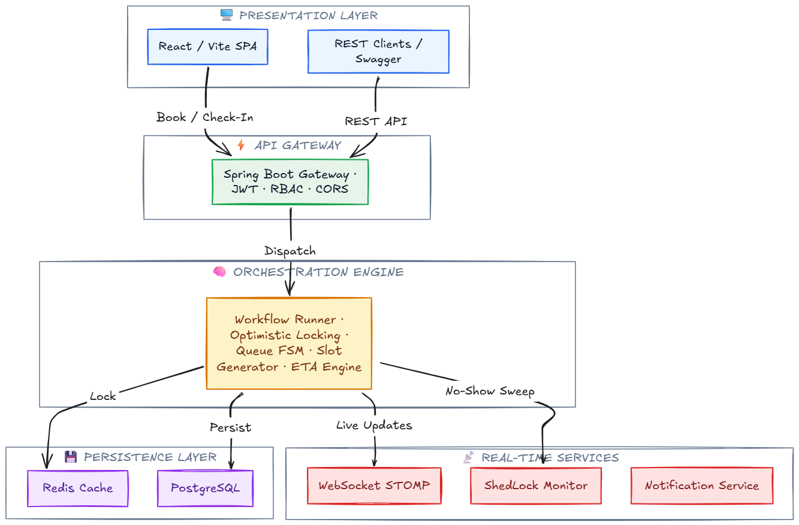
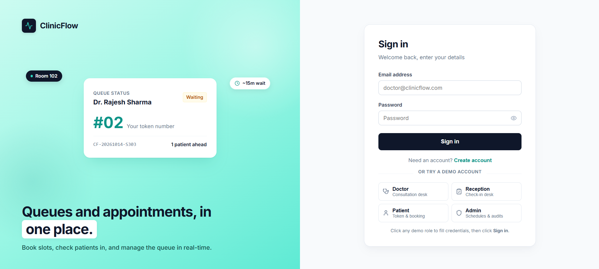
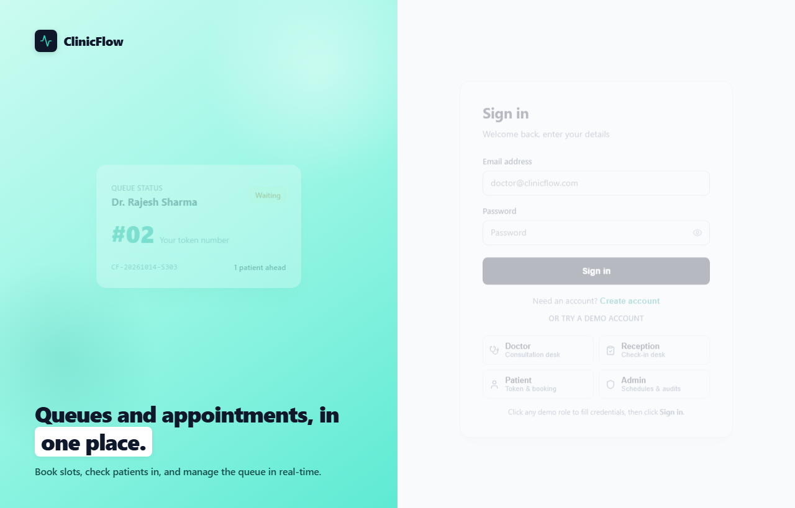
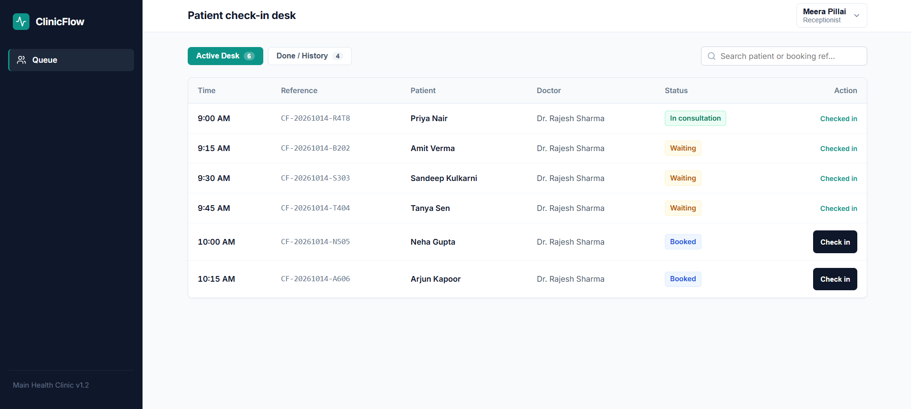
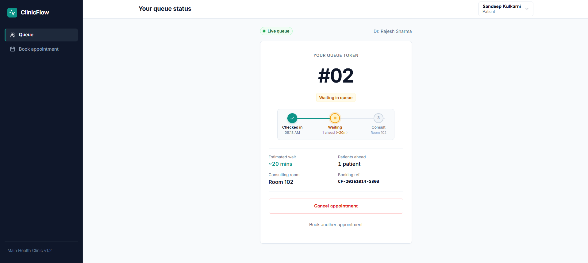
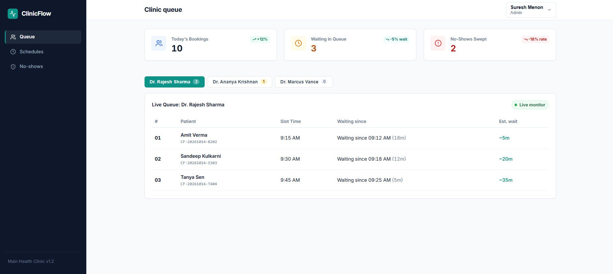

# ClinicFlow

[](https://clinicflow-live.vercel.app)
[](https://spring.io/projects/spring-boot)
[](https://react.dev/)
[](https://www.postgresql.org/)
[](https://redis.io/)

ClinicFlow is a clinic appointment and queue management web app built with Spring Boot and React. It helps manage patient queues in real time, handles appointment booking without double-booking, and provides simple views for patients, doctors, receptionists, and admins.

👉 **Live Demo:** [https://clinicflow-live.vercel.app](https://clinicflow-live.vercel.app) *(Includes one-click demo login buttons for each role)*

---

## Architecture



- **Frontend (React + Vite)**: Simple dashboard with views tailored to each role, smooth state transitions, and responsive layouts.
- **Backend (Spring Boot 3)**: REST API with stateless JWT authentication and role-based access (**DOCTOR, RECEPTIONIST, PATIENT, ADMIN**).
- **Real-Time Updates**: WebSocket (STOMP) for pushing live queue updates when patients are called or checked in.
- **Double-Booking Protection**: Database-level optimistic locking (`@Version`) and status checks so a time slot cannot be booked twice simultaneously (returns HTTP 409 Conflict).
- **Database & Cache**: PostgreSQL for persistent data and Redis for slot caching and lock coordination.

---

## Screenshots

### 1. Sign In
*Simple login screen with one-click demo buttons to try each role without typing.*

| Sign In & Demo Role Switcher |
| :---: |
|  |

---

### 2. Doctor Desk
*View waiting patients, call the next patient, and see quick vitals and consultation reasons.*

| Doctor Consultation Desk |
| :---: |
|  |

---

### 3. Reception Desk
*Check in arriving patients, view active vs completed visits, and search by name or reference number.*

| Reception Desk & Check-In |
| :---: |
|  |

---

### 4. Patient Portal
*Track live token number and wait status, or choose an open time slot to book an appointment.*

| Patient Queue Tracker & Booking |
| :---: |
|  |

---

### 5. Admin Dashboard
*Overview of doctor schedules, patient counts, and queue statistics.*

| Admin Dashboard |
| :---: |
|  |

---

## Tech Stack

- **Backend**: Java 21, Spring Boot 3.3.4, Spring Data JPA, Spring Security, Spring WebSocket (STOMP)
- **Database & Cache**: PostgreSQL 15, Redis 7, ShedLock
- **Frontend**: React 18, Vite, Framer Motion, Tailwind CSS, Lucide Icons, Axios, SockJS / StompJS
- **Deployment & Containers**: Docker, Docker Compose, Vercel

---

## Getting Started

### Option 1: Run with Docker Compose
From the project root:
```bash
docker-compose up -d --build
```

- **Frontend UI**: [http://localhost:5173](http://localhost:5173)
- **Backend API**: [http://localhost:8081](http://localhost:8081)
- **Swagger Docs**: [http://localhost:8081/swagger-ui.html](http://localhost:8081/swagger-ui.html)

### Option 2: Run Locally for Development

#### Backend (Spring Boot)
```bash
mvn clean package -DskipTests
java -jar target/clinicflow-0.0.1-SNAPSHOT.jar
```

#### Frontend (Vite + React)
```bash
cd frontend
npm install
npm run dev
```

---

## Demo Accounts

You can click any preset button on the sign-in page, or log in with:

| Role | Email | Password |
| :--- | :--- | :--- |
| **Doctor** | `doctor@clinicflow.com` | `doctor123` |
| **Receptionist** | `receptionist@clinicflow.com` | `reception123` |
| **Patient** | `patient@clinicflow.com` | `patient123` |
| **Admin** | `admin@clinicflow.com` | `admin123` |

---

## License
MIT
