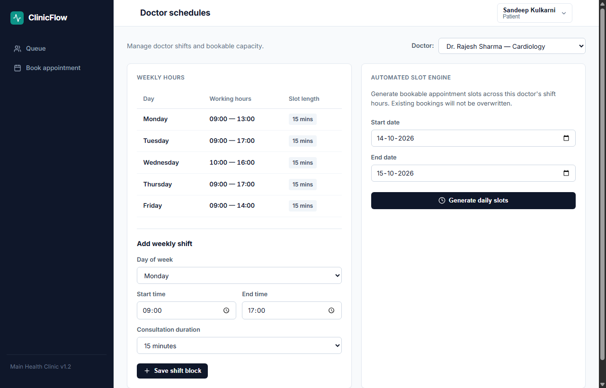
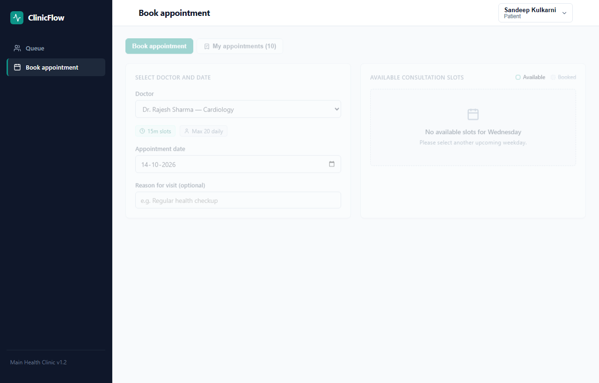
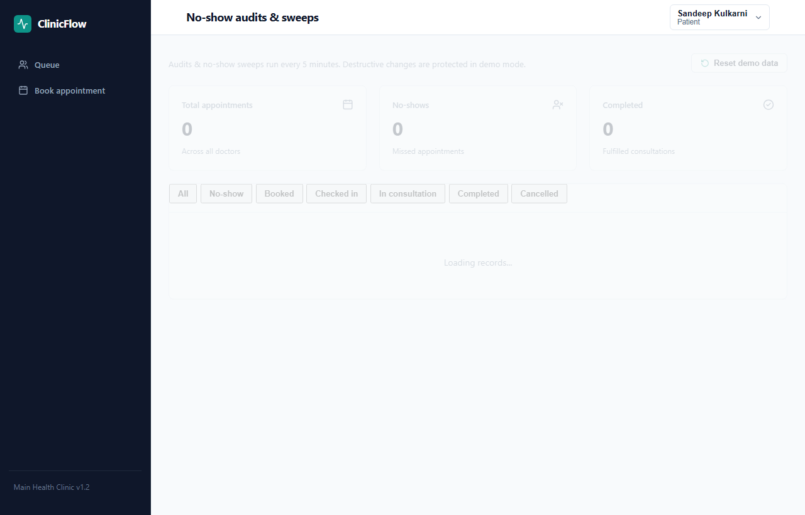

# ClinicFlow

[](https://clinicflow-live.vercel.app)
[](https://spring.io/projects/spring-boot)
[](https://react.dev/)
[](https://www.postgresql.org/)
[](https://redis.io/)

**ClinicFlow** is an enterprise-grade outpatient clinic management platform engineered to resolve real-time queue congestion, eliminate double-booking race conditions, and streamline clinical operations across Patients, Doctors, Receptionists, and Administrators.

👉 **Try the Live Application:** [https://clinicflow-live.vercel.app](https://clinicflow-live.vercel.app) *(Includes one-click demo role switching for instant testing)*

---

## System Architecture


ClinicFlow is built as a decoupled, multi-tier system with distributed state synchronization:

- **Presentation Layer (React 18 + Vite)**: Single-Page Application utilizing Framer Motion for 150ms state transitions, tactile micro-interactions, skeleton shimmer loaders, and responsive side drawers.
- **API Gateway & Security (Spring Boot 3.3)**: Stateless JWT authentication with fine-grained Role-Based Access Control (**DOCTOR, RECEPTIONIST, PATIENT, ADMIN**), unified exception mapping (`409 Conflict`, `400 Bad Request`), and production CORS filter policies.
- **Orchestration & Concurrency Control**:
  - **Optimistic Locking (`@Version`) + State Validation**: Guaranteed slot double-booking prevention returning clean `409 Conflict` under high concurrency.
  - **Redis Cache Invalidation & STOMP Broadcast**: Instant cache eviction on slot booking paired with WebSocket push notifications (`/topic/slots/{doctorId}` and `/topic/queue/{doctorId}`).
- **Distributed Scheduling (ShedLock)**: Horizontal cluster-safe background jobs (`NoShowMonitorJob`) sweeping expired slots and marking no-shows without duplicate task execution.
- **Data & Persistence**: **PostgreSQL 15** transactional storage managed via Spring Data JPA / Hibernate alongside **Redis 7** for rapid queue caching and distributed synchronization.

---

## UI & Clinical Workflows

### 1. Authentication & Onboarding
*Deel-inspired split layout with soft medical teal gradient, floating live queue pill highlights, and one-click demo role presets.*

| Split-Screen Sign-In & Demo Switcher |
| :---: |
|  |

---

### 2. Doctor Consultation Desk
*Zero-friction consultation workflow featuring quick-glance vitals (BP, Heart Rate, Last Visited, Allergies), chief complaint callout, glowing primary action button, and smooth gliding queue rows.*

| Consultation Vitals Card & Live Queue | Doctor Schedule & Availability Management |
| :---: | :---: |
|  |  |

---

### 3. Receptionist Desk & Patient Check-In
*Dual-tab operational desk separating Active Queue patients from Completed History, with real-time search, badge statuses, and an interactive slide-over patient profile drawer.*

| Active Check-In Desk & Side Drawer |
| :---: |
|  |

---

### 4. Patient Portal: Live Token & Appointment Booking
*Reassuring large token indicator (`#02`) with a 3-step visual progress bar (`Checked In` $\rightarrow$ `Waiting` $\rightarrow$ `In Consultation`), plus interactive slot selection with confirmation modal.*

| Real-Time Token Tracker | Interactive Slot Booking & Confirmation |
| :---: | :---: |
|  |  |

---

### 5. Clinic Operations & Administration
*Admin KPI metrics with positive/negative trend indicators, live patient count badges across doctor tabs, and automated ShedLock no-show auditing.*

| Admin Queue & Doctor Capacity Overview | Automated No-Shows & Cluster Audit |
| :---: | :---: |
|  |  |

---

## Key Engineering Highlights

### 1. Concurrency & Double-Booking Prevention
In high-demand clinics, multiple patients often attempt to book the same prime time slot concurrently. ClinicFlow implements a defense-in-depth approach:
1. **Pre-Save Status Validation**: `AppointmentService` confirms `slot.getStatus() == SlotStatus.AVAILABLE` before acquiring locks.
2. **JPA Optimistic Locking (`@Version`)**: Detects conflicting parallel transactions and raises an `ObjectOptimisticLockingFailureException`.
3. **HTTP 409 Conflict Handling**: `GlobalExceptionHandler` converts optimistic lock collisions and `SlotConflictException` into standardized `409 Conflict` payloads:
```json
{
  "status": 409,
  "error": "Conflict",
  "message": "This slot was just booked by another patient. Please choose another time.",
  "timestamp": "2026-10-14T21:45:00Z"
}
```
4. **Instant Invalidation & Broadcast**: The Redis slot cache is immediately evicted via `slotService.evictCache(doctorId, date)` and pushed via WebSocket to all listening clients to gray out the slot in real time.

---

### 2. Enterprise UI Polish & Tactile Transitions
- **Framer Motion State Transitions**: Completed patients fade out and glide upward smoothly without visual snapping.
- **Skeleton Shimmer Loaders**: Shimmering placeholder bars display during doctor tab switches and data loading, preventing jarring layout shifts.
- **150ms Page Route Fades**: Sub-route navigation applies a subtle 150ms upward fade (`opacity-0` to `opacity-100`, `translate-y-1`).
- **Tactile Micro-Interactions**: Subtle scale transitions (`scale(1.02)`) on hover and active depression (`scale(0.97)`) on click across all primary buttons.

---

## Technology Stack

| Layer | Technologies |
| :--- | :--- |
| **Backend** | Java 21, Spring Boot 3.3.4, Spring Data JPA, Spring Security, Spring WebSocket (STOMP), Lombok |
| **Database & Cache** | PostgreSQL 15, Redis 7, ShedLock Distributed Lock Provider |
| **Frontend** | React 18, Vite, Framer Motion, Tailwind CSS, Lucide Icons, SockJS & StompJS, Axios |
| **Testing & CI/CD** | JUnit 5, Concurrency Executor Multi-Thread Tests, Docker, Multi-Stage Dockerfile |
| **Cloud Hosting** | Vercel (Frontend Global CDN), Render / Railway (Spring Boot Container), Neon / Upstash |

---

## Getting Started

### Option 1: Run Full Containerized Stack (Docker Compose)
Run the following command from the repository root:
```bash
docker-compose up -d --build
```

This starts:
- **Frontend SPA**: `http://localhost:5173`
- **Backend API**: `http://localhost:8081` (or `8080`)
- **PostgreSQL**: `localhost:5432`
- **Redis**: `localhost:6379`

### Option 2: Run Locally for Development

#### 1. Backend (Spring Boot 3)
```bash
mvn clean package -DskipTests
java -jar target/clinicflow-0.0.1-SNAPSHOT.jar
```
*Swagger API Docs:* [http://localhost:8080/swagger-ui.html](http://localhost:8080/swagger-ui.html)

#### 2. Frontend (Vite + React)
```bash
cd frontend
npm install
npm run dev
```
*Frontend Web UI:* [http://localhost:5173](http://localhost:5173)

---

## Demo Credentials

Click any preset on the Login screen, or use the following credentials:

| Role | Email | Password | Primary Feature |
| :--- | :--- | :--- | :--- |
| **Doctor** | `doctor@clinicflow.com` | `doctor123` | Consultation desk, patient vitals, call next |
| **Receptionist** | `receptionist@clinicflow.com` | `reception123` | Patient check-in desk, slide-over drawer |
| **Patient** | `patient@clinicflow.com` | `patient123` | Live `#02` token progress, interactive slot booking |
| **Admin** | `admin@clinicflow.com` | `admin123` | KPI trend metrics, schedule manager, no-show audit |

---

## License
MIT License. Built to demonstrate high-concurrency architecture and modern clinical workflow ergonomics.
